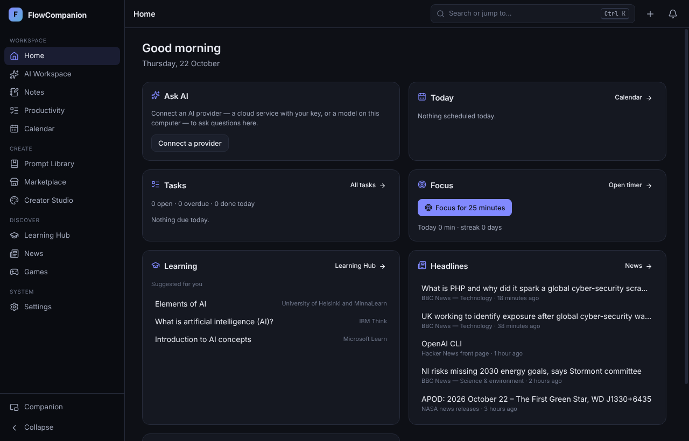
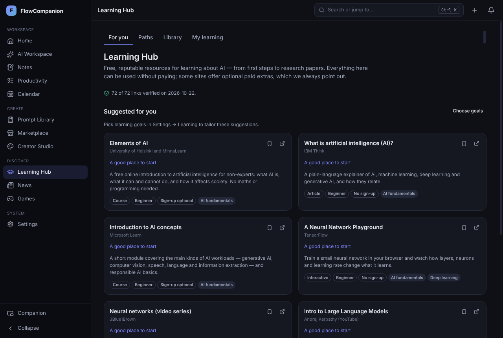
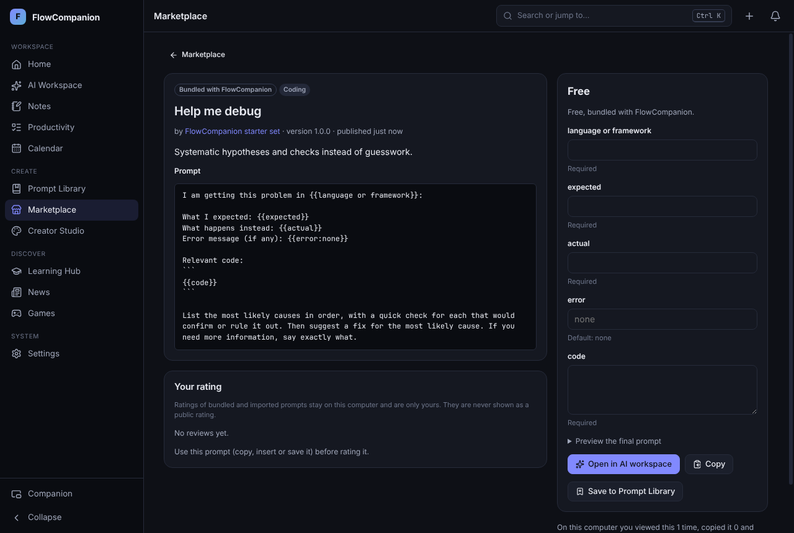
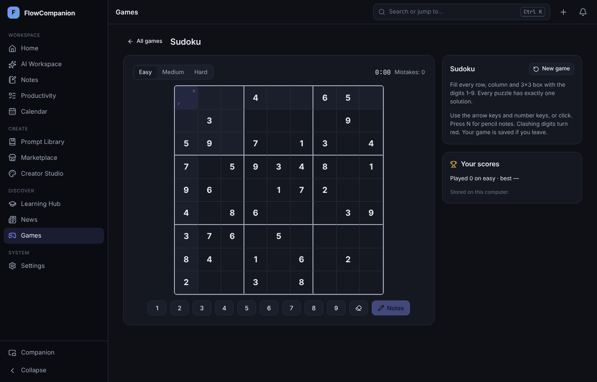

# FlowCompanion

A standalone desktop workspace for AI, productivity, learning and personal organisation. Your data stays on your computer in a local SQLite database; every module works without an account, a browser extension or an AI provider.

> **Status: 1.0.0 development build.** Built and tested on Linux (Electron 44). Windows and macOS packages are cross-built but unsigned and have not been run on those systems. See [docs/FEATURE_MATRIX.md](docs/FEATURE_MATRIX.md) for exactly what is verified and [docs/KNOWN_LIMITATIONS.md](docs/KNOWN_LIMITATIONS.md) for what is not.

## What is in it

| Area | Highlights |
| --- | --- |
| **AI workspace** | Conversations with streaming, cancel, retry, Markdown/code rendering, search, export, “save as note/task”, system instructions. Providers: OpenAI, any OpenAI-compatible server (llama.cpp, LM Studio, vLLM…), Anthropic Claude, Google Gemini, Ollama. Keys are kept in OS secure storage when available. |
| **Floating companion** | Small always-on-top panel and launcher: quick capture, ask AI, today’s agenda, focus timer. Move, resize, dock left/right, collapse, opacity, tray, global shortcuts. |
| **Notes** | Markdown or plain text, autosave with crash recovery, folders, tags, favourites, pins, full-text search, links between items, trash, import/export (JSON, Markdown, text). |
| **Productivity** | Tasks with subtasks and due dates, quick capture, Pomodoro focus timer, time tracker, study planner, bookmarks and reading queue, calculator and unit converter. |
| **Calendar** | Day/week/month/agenda views, recurrence with exceptions, time zones and DST, reminders that survive restarts and never repeat, quiet hours, snooze, ICS export. |
| **News** | 21 publisher RSS/Atom feeds plus your own, attribution on every item, previews only, duplicate collapsing, search, saved items, blocked sources, keyword alerts. |
| **Games** | Word guess, Sudoku, memory match, AI trivia, reaction time — with rules, difficulty levels, keyboard play, reduced-motion support and local scores. |
| **Learning Hub** | 72 free AI learning resources from universities, non-profits, public bodies and companies, every link checked by a script; nine learning paths; progress, notes, study scheduling. No invented ratings or durations. |
| **Prompt library** | Prompts with `{{variables}}`, versions you can restore, provider labels, import/export, “open in AI”. |
| **Marketplace & Creator Studio** | Free bundled starter prompts, listing files, and an optional marketplace server (reference implementation in `server/`) with accounts, moderation, verified reviews and server-enforced 7-day trials. **No payments**: purchases are never simulated. |
| **Parental Learning Controls** | Optional and off by default: block copying AI answers, tutor mode, supervised study sessions, best-effort screen-capture privacy — with honest per-OS limits. |
| **Browser extension** | Optional Chromium extension that saves pages/selections to FlowCompanion over a paired, loopback-only bridge. |

## Screenshots

Taken from the packaged Linux build and the end-to-end test runs (dark theme).

| Home | Learning Hub |
| --- | --- |
|  |  |
| **Marketplace listing** | **Sudoku** |
|  |  |

## Quick start (from source)

Requirements: Node.js 22.13+ (24 recommended) and npm 10+.

```bash
npm ci
npm start            # builds and launches the app
```

Running as root on Linux (e.g. in a container) needs `npx electron . --no-sandbox` after `npm run build`.

Other commands: `npm run check` (typecheck, lint, unit/integration tests), `npm run test:e2e` (Playwright, needs a display or `xvfb-run`), `npm run dist:linux` (AppImage + deb), `npm run server` (reference marketplace server), `npm run verify:links` (check every Learning Hub link).

## Documentation

- [Installation and configuration](docs/INSTALL.md)
- [Developer setup](docs/DEVELOPMENT.md)
- [Architecture](docs/ARCHITECTURE.md)
- [Privacy and data flows](docs/PRIVACY.md)
- [Security checklist](docs/SECURITY.md)
- [Settings reference](docs/SETTINGS.md)
- [Parental Learning Controls](docs/PARENTAL_CONTROLS.md)
- [Marketplace and creator policy](docs/MARKETPLACE_POLICY.md)
- [Test report](docs/TEST_REPORT.md)
- [Feature completion matrix](docs/FEATURE_MATRIX.md)
- [Known limitations](docs/KNOWN_LIMITATIONS.md)
- [Release checklist and versioning](docs/RELEASE.md)
- [Implementation checklist](docs/IMPLEMENTATION_CHECKLIST.md)
- [Delivery report](docs/DELIVERY_REPORT.md)

## Licence

MIT. Learning Hub resources and news articles belong to their publishers; FlowCompanion links to them and shows short previews only.
